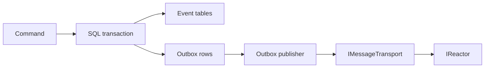

# Outbox

Use SQL Server plus `EnableOutbox` when the consumer is another process.
The publisher hands each row to `IMessageTransport`. The in-process
transport delivers in the same process. RabbitMQ and Azure Service Bus
deliver through a broker. A dead-lettered row returns to the publisher
after `ResetDeadLetteredAsync` or `ResetAllDeadLetteredAsync`. See
[Outbox pattern](../OUTBOX_PATTERN.md#dead-letters).
