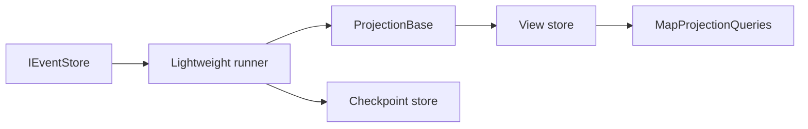

# Projection pipeline

The runner applies `ProjectionBase<TView>` handlers. Stores are in-memory
(`AddInMemoryProjectionStores`), SQL Server (`AddSqlProjectionStores` in
`LawnDart.Projections.Lightweight.SqlServer`), or Postgres
(`AddPostgresProjectionStores` in `LawnDart.Projections.Lightweight.Postgres`).
